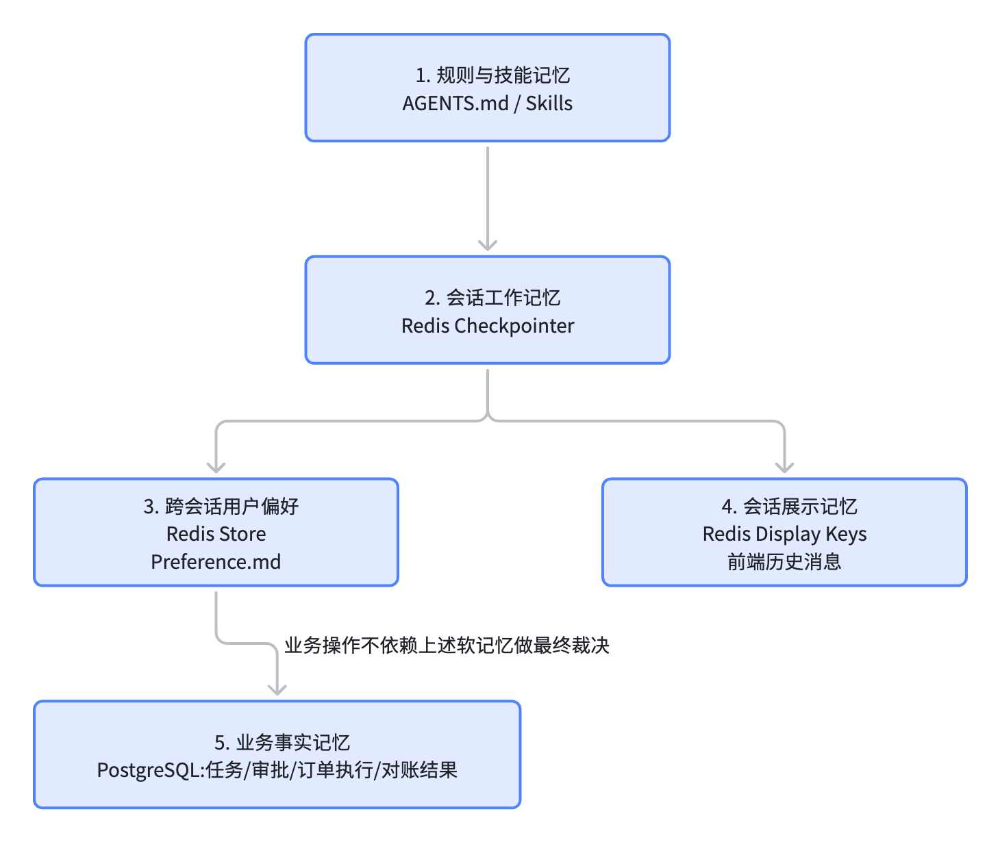

# 会记住偏好，不会记错订单：AI 采购 Agent 的分层记忆

> Agent 的记忆不是一个“存聊天记录的数据库”。可靠的企业 Agent 必须区分用户偏好、会话状态、业务事实和全局规则，并让每一类信息由正确的存储、生命周期和权限边界管理。

## 引子：一个“记性很好”的Agent，也可能记错东西

周三上午，采购员打开一个新的聊天窗口，对ERP助手说：“还是用上次那种方式，帮我做一下x产品的供应商对比”；助手记得上周用户更偏好表格，于是这次直接生成了结构化采购对比表格，这个体验很好，用户没有重复说明，偏好跨回话延续了。

但是如果助手接着这样推理："上周关注过供应商A,所以这次也默认选择A";这样就危险了，供应商可能已经停用了，可能供应商的报价过期了，这次采购可能有不同的仓库、预算、交期要求，过去的关注记录可以帮助缩短选择范围，却不能代替这次查询得到的事实，更不能直接进入采购订单。

以上两段行为看似来都属于“Agent记住了东西”，但性质完全不同：

- “用户喜欢表格”是偏好，可以跨回话长期存储
- ”这次应该向哪家供应商“是业务判断，必须给予本次查询和校验
- “服务重启后从审批节点继续”是执行状体啊，必须可恢复的流程快照
- “订单号190已创建“是业务事实，必须可审计，不能只存在对话摘要里

这正是Agent记忆设计最容易出问题的地方：系统把所有信息都成为“记忆”，却没有区分哪些可以推测、哪些可以覆盖、哪些必须来自权威数据。所以，这拼文章不从“怎样把更多内容塞进上下文”开始，而是从一个更基础的问题开始：**Agent应该记住什么？又绝不能擅自假定什么？**在本项目中，答案可以概括为：**规则要稳定，会话要可恢复，偏好要跨会话，展示要可回放，业务事实要可审计**，它们不是同一种记忆

## 一：先把记忆拆成五种不同的东西

### 1. 判断Agent记忆，先问四个问题
在设计存储之前，项目首先要回答四个问题

#### 第一问：这条记忆存活多久？

- 一轮对话中临时出现的工具结果，可能只需要活到本轮结束
- 用户的偏好内容则需要长期保留
- 一笔采购任务的审批状态则需要在数月甚至更久以后仍能查询和审计

#### 第二问：它属于谁？

- 一条偏好属于当前用户
- 一段对话状态属于当前会话线程
- 一笔采购任务属于发起者、审批人和相关组织
- 订单执行结果则属于企业业务系统

如果作用范围不清楚，就很容易发生数据串用

#### 第三问：它是什么类型的信息？

可以把本项目中的信息粗略分为四类：

|信息类型|示例|能否由模型推测|
|---|---|---|
|行为规则|“订单必须经过人工审批”|不能|
|用户偏好|“报告默认使用表格”|可以，但应允许修改|
|工作状态|“当前停在待审批节点”|只能依据流程状态恢复|
|业务事实|“订单 190 已创建”|不能|

模型可以综合和解释这些信息，但不能重新定义规则，也不能把推测包装成事实


#### 第四问：它有多权威

不同记忆的权威程度也不同：

```text
用户偏好  -> 可更新、可遗忘
对话摘要  -> 可压缩、可缺失
流程Checkpoint  -> 可用于恢复，但不是业务真相
审批记录  -> 受版本、权限和时间约束
订单执行记录 -> 权威业务事实
```

当偏好、摘要和业务数据库相互冲突时，系统必须知道应该相信谁。对一个交易型Agent来说，这个答案通常不是“模型记得的那个”，而是**审批表、任务表和订单执行表中的持久化事实**

### 2. 这个项目的五层记忆

基于上述区分，项目形成了五层职责不同的记忆



对应职责可以整理成一张表：

| 记忆层    | 存储基础               | 隔离维度             | 主要内容         | 丢失后的行为             |
| ------ | ------------------ | ---------------- | ------------ | ------------------ |
| 规则与技能  | 沙箱与 Store          | 全局 / Agent scope | 行为准则、技能、工作方法 | 规则不能静默降级           |
| 会话工作记忆 | Redis Checkpointer | `thread_id`      | 图状态、消息、中断点   | 会话无法正常恢复           |
| 用户长记忆  | Redis Store        | `user_id`        | 偏好、近期供应商和查询  | 回退默认偏好             |
| 展示记忆   | Redis Key          | `thread_id`      | 用户实际看到的完整消息  | 可从 Checkpoint 部分回退 |
| 业务事实   | PostgreSQL         | `task_id` 等      | 审批、订单、执行结果   | 不能靠聊天记录猜测          |

这五层看起来都叫“记忆”， 但生命周期、权限和失败语义完全不同

#### 第一层：规则与技能，决定Agent应该怎样工作

这一层包含两类内容：

- /AGENTS.md: 行为准则、安全边界、委派规则
- /skills/: 完成特定任务时使用的工作方法

AGENTS.md 由开发者维护，Agent可以读取它，但不应该在运行时改写自己的核心规则。

技能更像”程序性记忆“：它不告诉Agent 用户喜欢什么，而是告诉Agent如何完成某类工作，例如怎样分析采购数据或者怎样管理技能。

这一层的意义是让Agent的行为具有稳定基线。用户偏好可以变化，业务方案可以变化，但“关键操作必须校验”，“订单必须经过审批”，这样的规则不能因为某次上下文压缩而消失

#### 第二层：会话工作记忆，让流程能够跟着走

用户在聊天中发出一句话后，系统不仅需要保存这句话，还需要保存：

- 已经调用了哪些工具
- 收到过哪些结果
- 当前在哪个图节点
- 是否正等待用户补充信息或审批
- 下一步应该恢复哪个节点

这些信息由Redis Checkpointer 按thread_id保存。它解决的是“这次对话执行到了哪里”，而不是“这位用户长期喜欢什么”。

例如，用户在审批弹窗出现时关闭页面，之后重新打开，系统能够从同一个Checkpointer恢复待审批状态，而不是重新解析需求、查询库存和生成一份新文档。

#### 第三层：用户长记忆，让偏好跨回话延续


用户偏好保存在Redis Store中，在Agent看来则是
`/memories/{user_id}/perferences.md`

例如：

```text
preferred_output: table
preferred_chart_type: bar
preferred_currency: CNY
preferred_language: zh

recent_suppliers:
  - 博世
  - 大陆

recent_queries:
  - 刹车片价格对比分析
  - Q2 线束采购预算评估
```

这些信息与具体聊天线程无关，因此新开回话后仍可以读取，但要注意其中的语义差异：

- preferred_output 是可以直接应用的偏好
- recent_suppliers 只是最近关注过的供应商
- recent_queries 只是最近做过的查询摘要

后两项可以帮助Agent理解上下文，却不能自动成为本次采购的事实。

“最近关注过博世”和“这次应该采购博世”之间，隔着实时查询、规则校验和人工审批

#### 第四层：展示记忆，让用户看到的历史能够还原

只保存Agent的图状态，并不一定足以还原用户在界面中看到的完整历史

聊天页面中可能同时包含：

- 用户输入
- 主Agent 的文本
- 主Agent 调用子Agen的过程
- 子Agent返回的结果
- 工具调用和图表
- 审批中断卡片

LangGraph 主要服务于工作流执行，而前端历史记录还需要一套面向展示的消息投影，因此项目会按thread_id将流式过程中形成的完整消息另外保存到Redis

```python
erp:session_display:{thread_id}
```

这形成了两个不同的问题：

```python
执行记忆：Agent应该从哪里继续？
展示记忆：用户刷新页面后应该看到什么？
```

两者有交集但不能相互替代


#### 第五层：业务事实，不能被“记忆”替代

采购任务、审批方案和订单执行结果保存在PostgreSQL中，包括：

- 任务属于哪个用户
- 当前是待审批、执行中还是待核验
- 用户批准的是哪一版方案
- 方案内容哈希是什么
- 订单是否创建成功
- 远端订单内容是否与方案一致
- 订单是否需要人工复核

这些信息必须可查询、可审计、可约束

例如，当Agent的对话摘要写着“用户已同意”时，执行服务仍要重新读取审批记录，检查：

- 审批确实存在
- 审批状态是approved
- 审批人存在
- 审批没有过期
- 审批对应的任务、版本和方案哈希与当前方案一致

这是Agent 记忆与业务事实之间最重要的一条边界：**对话可以承载意图，业务数据才能承载承诺**


### 3. 为什么五层记忆最终落到三种标识上

多类记忆如果只靠thread_id 管理，很快就会混淆；例如用户从新开启一场对话，是否应该看到旧会话中的订单？同一个会话中是否可以启动两笔采购？

项目的做法是让不同标识承担不同的职责：

```text
user_id         → 谁在使用系统
conversation    → 当前聊天上下文
thread_id       → Checkpoint 从哪条线程恢复
task_id         → 对应哪一笔采购业务
approval_id     → 批准的是哪一版具体方案
```

可以用一个对应关系理解：

```text
一位用户
  └─ 开启多个聊天会话
       └─ 每个会话有一个 thread_id
            └─ 聊天中可能启动采购任务
                 └─ 每笔任务有独立 task_id
                      └─ 每版方案绑定独立 approval_id
```

这也是为什么不能用user_id去读取Checkpoint, 也不能用thread_id判断一笔订单是否已经批准

不同标识背后代表的是不同记忆边界。


### 4. 代码如何把“文件接口”路由到正确的存储

在本项目中，Agent看到的是统一的文件路径，不需要关心某类文件实际存在哪里。主Agent用CompositeBackend 完成路径分流：

```python
backend = CompositeBackend(
    default=sandbox_backend,
    routes={
        "/memories/": StoreBackend(
            store=STORE,
            namespace=_user_namespace,
        ),
        "/persisted-skills/": StoreBackend(
            store=STORE,
            namespace=lambda _rt: SKILLS_STORE_NAMESPACE,
        ),
    },
)
```

可以理解为一条一条“存储路由规则”：

```text
/memories/{user_id}/...     → Redis Store，跨会话保存
/persisted-skills/...       → Redis Store，跨沙箱恢复技能
/analysis/...               → OpenSandbox，任务临时文件
/data/...                   → OpenSandbox，任务临时数据
/AGENTS.md                  → 沙箱中的只读规则文件
```

对模型来说，它仍可以用read_file,write_file等熟悉的工具；对系统来说，不同字符串路径已经映射到了完全不同的生命周期和隔离范围。这比要求模型自己记住“偏好要写Redis,分析文件写沙箱”可靠的多。存储策略由基础设施决定，模型只需要表达读取或写入意图。

## 二：一次请求，如何穿过五层记忆？

第一部分给出了记忆的分类。现在换一个更具体的视角：用户发送一句采购需求后，系统到底读取了哪些记忆、写了哪些记忆，又分别把它们放在哪里？

假设用户在一个新会话中说：“帮我比较一下活塞环的供应商报价，报告还是用表格”

这条消息会触发多种记忆行为：

- 系统需要知道”报告还是用表格“来自这位用户的长期偏好
- Agent需要读取全局规则，判断这次请求是普通分析还是完整采购任务
- LangGraph需要把当前调用、工具结果和中断位置写入会话Checkpointer
- 前端需要把用户实际看到的流式消息保存成可回放的展示记录
- 如果这次操作最终生成采购任务，任务状态、审批和订单结果必须进入PostgreSQL

这些动作看起来都与“记忆”有关，实际却发生在不同层级、不同粒度，也有不同的失败语义。

### 6. 请求之前：先把记忆基础设施装配好

Agent的记忆不是在用户第一条消息到达后才临时创建的。应用启动时，系统先完成存储链接和路径路由的装配，这一阶段主要完成三件事

#### 第一件事：连接Redis Checkpointer和Store

项目使用同一个Redis作为两类逻辑存储的后端：

```python
CHECKPOINTER = AsyncRedisSaver(redis_url=REDIS_URL)
STORE = RedisStore(REDIS_CLIENT)
```

但它们承载的内容不同：

- Checkpointer保存LangGraph线程的执行状态
- Store保存跨线程、跨会话的用户偏好

虽然物理上都使用Redis,但绝不能因为“同一个数据库”就把它们视为同一种记忆。

Checkpointer的典型问题是：这条会话执行到了哪个节点？

Store的典型问题是：这位用户长期偏好是什么？

问题不同，查询方式和生命周期也不同。

#### 第二件事：安装全局规则

AGENTS.md 由项目开发者维护，启动时被上传到沙箱/AGENTS.md，随后通过create_deep_agent的memory参数注入主Agent:

```python
agent_graph = create_deep_agent(
    model=MAIN_MODEL,
    system_prompt=system_prompt,
    skills=["/skills/main"],
    memory=[AGENTS_MD_FILENAME],
    ...
)
```

这部分内容的生命周期和用户无关，无论谁发起请求，核心规则都应保持一致。

规则记忆与用户记忆的差别在于：

```text
AGENTS.md      -> 系统允许Agnet怎样行动
preferences.md -> 当前用户希望Agent怎样表现
Checkpoint.    -> 当前任务执行到了哪里
```

把三者混到一起，就可能出现“用户要求用表格，于是Agent认为以后的采购审批也可以用表格代替”的荒谬情况，偏好可以影响表达方式，但不能覆盖安全和业务规则

#### 第三件事：安装文件路径分流

第一部分已经看到CompositeBackend 把/memories/路由到Store,完整启动流程还同时安装了技能同步和技能恢复中间件：

- SkillsSyncMiddleware: 把项目内置技能同步到沙箱
- UserSkillsRestoreMiddleware: 把跨会话持久化的技能恢复到新沙箱
- MemoryUpdateMiddleware: 在每轮回复后维护用户近期记忆

主Agnet 中间件栈大致是：

```python
main_middleware = [
    TodoListMiddleware(),
    ContextInjectionMiddleware(),
    SkillsSyncMiddleware(sandbox_backend),
    UserSkillsRestoreMiddleware(sandbox_backend, SKILLS_STORE_NAMESPACE),
    build_summarization_middleware(backend, SUMMARY_MODEL),
    MemoryUpdateMiddleware(model=SUMMARY_MODEL),
    ModelCallLimitMiddleware(run_limit=50),
    ToolCallLimitMiddleware(run_limit=200),
]
```

从顺序上可以看到，记忆不是一个独立模块，而是通过多个中间件嵌入Agent生命周期的不同阶段：

```text
请求前：注入用户身份、同步技能、恢复持久化技能
运行中：维护图状态和上下文
回复后：提取近期供应商和查询
```

### 7. 请求开始时：先确定“现在是谁在说话”

当用户消息进入Agent，第一步不是让它读取全部历史对话，而是告诉它当前运行时身份

ContextInjectionMiddleware 从运行上下文获得用户信息，在以系统消息形式注入：

```python
notice = (
    f"【系统上下文】\n"
    f"当前用户user_id: {user_id}\n"
    f"当前用户username: {username}\n"
    f"用户偏好文件路径: /memories/{user_id}/preferences.md\n\n"
    f"请首先使用read_file 读取上述偏好文件，了解用户偏好。\n"
    f"(recent_suppliers和recent_queries 由系统自动维护，无需手动更新)"
)
```

这段代码承担的是“记忆寻址”。

如果没有明确的user_id, Agent即使拥有读文件的能力，也不知道该读取哪一位用户的偏好。更严重的是，如果模型自己从聊天内容中猜用户身份，救可能读错、写错、甚至泄露其他用户的数据

因此可靠的记忆系统必须满足一个前置条件：**记忆地址来自可信的运行时身份，而不是来自模型的推测**

运行时上下文由ProcurementContext承载：

```python
@dataclass
class ProcurementContext:
    user_id: str
    username: str
    roles: tuple[str, ...] = ()
```

从概念上说，一起请求开始时形成了如下寻址关系：

```text
当前请求
  ├─ user_id     → /memories/{user_id}/preferences.md
  └─ thread_id   → Redis Checkpointer 中的某条线程
```

一个决定读哪份长期记忆，另一个决定恢复哪一段会话状态

#### Agent 读到偏好后做什么？

偏好文件本身是普通文本，不会自动改变程序行为。主Agent 读取后，把其中的信息应用到当前任务，例如：

- preferred_output: table 影响报告格式。
- preferred_chart_type: bar 影响图表工具参数。
- preferred_currency: CNY 影响分析展示。
- recent_suppliers 作为上下文提示，但不能替代实时供应商查询。

这也是“读取记忆”与“相信记忆”之间的区别

读取只是知道；是否使用、以什么权威程度使用，还取决于信息类型。

### 8. 长期偏好：用文件接口访问Redis Store

用户偏好路径看起来很普通：

```text
/memories/{user_id}/preferences.md
```

但项目并不是把这份文件写入OpenSandbox。主Agent构建时安装了路由：

```python
backend = CompositeBackend(
    default=sandbox_backend,
    routes={
        "/memories/": StoreBackend(
            store=STORE,
            namespace=_user_namespace,
        ),
    },
)
```

这里的_user_namespace又来自运行时上下文：

```python
def _user_namespace(rt):
    context = getattr(rt, "context", None)
    user_id = getattr(context, "user_id", "guoyaxing")
    return (user_id,)
```

因此，Agent看到的一条路径最终会被拆成：

```text
可见路径：
/memories/alice/preferences.md

逻辑挂载点：
/memories/

Store 命名空间：
("alice",)

Store 内部 Key：
/alice/preferences.md
```

可以理解成给文件系统挂了一个远程目录：

```text
沙箱里的 /memories/
        ↓ 挂载
Redis Store 中的用户专属目录
```

用户和 Agent 都不需要处理 Redis Key，也不需要知道 Store 的底层 API。路径本身就是权限与隔离边界。

#### 为什么不在沙箱里直接保存？

沙箱主要是任务运行时环境，适合：

- 临时下载的数据
- 分析中间文件
- 生成的报告和图表
- 执行代码

如果用户偏好只放在沙箱里，新会话创建新沙箱后，偏好就消失了。而如果把所有用户偏好都放在沙箱的同一个/memories/目录中，又很难保证用户之间的隔离，所以项目采用了一个折中：

- 对Agent暴露熟悉的文件工具
- 对系统使用user_id命名空间隔离
- 对底层使用Redis Store实现跨会话持久化

#### 偏好文件长什么样？

当前项目的偏好文件主要保存这些字段：

```text
preferred_output: table
preferred_chart_type: bar
preferred_currency: CNY
preferred_language: zh

recent_suppliers:
  - 博世
  - 大陆

recent_queries:
  - 刹车片价格对比分析
  - Q2 线束采购预算评估
```

前四个字段代表可以直接应用的明确偏好。后两个字段更接近“近期上下文”

- recent_suppliers 用于提示用户最近关注过哪些供应商。
- recent_queries 用于帮助 Agent 理解近期的采购关注方向。

它们具有不同的权威程度。前者可以影响输出方式，后者只能帮助理解，不能直接变成采购决策。

### 9. 偏好如何写回：显式修改与自动更新并行

记忆系统不仅需要读取，还需要决定“什么时候写”

这个项目目前采用两条写入路径：

#### 路径一：用户明确表达偏好，由 Agent 修改文件

例如用户说：“以后采购分析都先给我一张表格，再附趋势图。”这是一条明确、稳定的偏好。主 Agent 根据系统规则更新：

```text
/memories/{user_id}/preferences.md
```

这条路径的优点是语义清楚，用户可以感知并纠正。缺点是它依赖 Agent 是否理解并执行了写文件操作。因此系统提示词必须明确告诉 Agent：用户表达了长期偏好时，需要更新对应文件。

#### 路径二：回复完成后，由中间件自动维护近期信息

用户不一定每次都会明确说“请记住”。例如用户完成一次供应商询价后，系统可以自动记录：最近关注过博世和大陆。MemoryUpdateMiddleware 在每轮 Agent 回复完成后执行，主流程是：

```text
Agent 回复完成
    ↓
检查最后一条用户消息是否与企业采购有关
    ↓
提取 AI 回复摘要
    ↓
调用摘要模型，提取供应商和查询描述
    ↓
读取现有 preferences.md
    ↓
合并、去重、限制长度
    ↓
写回 Redis Store
```

异步钩子的核心位置如下：

```python
async def aafter_agent(self, state, runtime):
    ctx = getattr(runtime, "context", None)
    user_id = getattr(ctx, "user_id", None)

    user_message = _is_meaningful_erp_exchange(messages)
    extracted = await _extract_entities(
        self.model, user_message, ai_summary
    )

    store = getattr(runtime, "store", None)
    namespace = (user_id,)
    key = f"/{user_id}/preferences.md"

    item = await store.aget(namespace, key)
    updated_content = _merge_preferences(...)
    await store.aput(namespace, key, file_value)
```

#### 为什么不是每轮都写

自动记忆如果过于积极，很容易污染用户画像，因此中间件先做了一次有意义的交互判断：

- 消息中是否包含采购、供应商、价格、库存等关键词
- 本轮消息是否委派过子Agent
- 是否明确属于问候或记忆查询，需要跳过

#### 写入失败时怎么做？

MemoryUpdateMiddleware 的外层会捕获异常并记录警告，不让自动记忆失败影响主回复。

这样做的考量是：

- 用户已经完成了当前任务
- 少记录一条“近期供应商”不会破坏今天的采购结果
- 为了写一条辅助记忆而让整个对话失败，会造成更大的体验损失

但这也带来一个需要在生产环境中重新评估的问题：记忆更新是“尽力而为”，还是“必须成功并进入重试队列”？

**对于普通近期偏好，可以采用尽力而为；对于用户明确说“以后必须记住”的重要偏好，则可能需要更明确的确认和持久化状态。**

### 10. 会话状态：Checkpointer与展示记忆为什么分开？

进入一次会话后，系统还需要记住两类完全不同的东西：

#### 第一类：Agent应该从哪里继续

LangGraph Checkpointer按thread_id保存图执行状态，包括：

- 当前消息
- 中间工具结果
- 当前节点
- 待处理的中断
- 恢复流程所需的状态字段

这部分用于继续推理和执行

例如，完整采购流程在等待人工审批时发生中断，Checkpointer 会保存当前方案、审批 ID、版本和哈希。用户稍后点击按钮时，系统可以从待审批节点继续，而不需要重跑前面所有步骤。

#### 第二类：用户刚才在界面上看到了什么

一次对话流中可能包含许多 LangChain 内部消息与子 Agent 消息。前端历史需要的是另一种投影：

```text
用户消息
主 Agent 文本
调用了哪个工具
工具是否完成
子 Agent 返回了什么
图表在哪里
```

另外，项目维护了：

```text
erp:session_display:{thread_id}
erp:session_meta:{thread_id}
erp:threads
```

读取历史时，API 会优先使用这份展示记忆：

```python
serialized = await agent_loader.get_display_messages(thread_id)

if not serialized:
    messages = await agent_loader.get_current_messages(thread_id)
    serialized = serialize_messages_from_checkpoint(messages)
```

这形成了一个清晰的回退链：

```text
完整展示记忆
    ↓ 不存在或不可用
从 Checkpoint 序列化主 Agent 消息
```

从Checkpoint回退时，子Agent的完整过程和部分多模态信息可能无法完全恢复，但主流程和主要消息仍可展示。

#### 删除会话时，用户偏好不应被删除

当用户删除一条会话时，应当清理：

- 这条线程的checkpoint
- 这条线程的展示消息
- 会话列表中的索引与更新时间

但不应删除用户的长期偏好。这个区分非常实际。用户清理聊天历史时，通常不代表希望下一条对话忘记他偏好的报告格式、图表类型和语言。目前 AgentLoader.delete_session() 会删除 Checkpoint 线程、展示消息、会话元数据和线程索引，而 /memories/{user_id}/preferences.md 会继续保留。


### 11. 业务任务：Checkpointe之外还需要一层任务事实

到目前为止，系统已经记住了：

- 全局规则与技能
- 用户偏好
- 会话执行状态
- 会话展示历史

但最重要的采购任务，不能只依赖这些内容，完整采购任务启动时，系统会先向PostgreSQL写入任务记录:

```python

task_id = new_task_id(now)
thread_id = task_thread_id(task_id)

await self._tasks.create(
    TaskRecord(
        task_id=task_id,
        thread_id=thread_id,
        user_id=user_id,
        status=TaskStatus.RUNNING.value,
        created_at=now,
        updated_at=now,
    )
)
```

随后它通过固定映射获得 Checkpoint 线程：

```python
def task_thread_id(task_id: str) -> str:
    return f"procurement:{task_id}"
```

这里形成了双层记忆：

| 问题                   | 数据来源             |
| -------------------- | ---------------- |
| 这张图下一步执行什么节点？        | Redis Checkpoint |
| 这笔采购任务属于谁、当前业务状态是什么？ | PostgreSQL 任务表   |

为什么要分开？

因为 Checkpoint 是工作流执行快照，不是业务档案。如果 Checkpoint 被清理、格式升级后无法反序列化，或者图结构已经变化，业务系统仍需要知道：

- 曾经存在过一笔任务。
- 它由谁发起
- 它是否得到审批
- 是否已经创建订单

因此任务的权威状态必须进入业务表

继续往下，审批和应用执行事实也各自有专门的持久化记录：

- task_repository.py: 任务归属于状态
- approval_repository.py: 具体方案审批
- execution_repository.py: 订单执行事实

这时，本文开头提到的不同标识终于形成完整分工：

```text
user_id
  决定读取哪一份长期用户记忆

thread_id
  决定恢复哪一段 Checkpoint 和展示历史

task_id
  决定读取哪一笔采购业务

approval_id
  决定信任哪一次具体方案审批
```

一张表总结：

| 记忆对象   | 典型标识            | 是否可推测 | 是否是业务真相 |
| ------ | --------------- | ----- | ------- |
| 用户偏好   | `user_id`       | 部分可以  | 否       |
| 会话执行状态 | `thread_id`     | 不能    | 否       |
| 会话展示历史 | `thread_id`     | 不能    | 否       |
| 采购任务   | `task_id`       | 不能    | 是，业务状态  |
| 方案审批   | `approval_id`   | 不能    | 是，审批事实  |
| 订单执行   | 执行键 / `task_id` | 不能    | 是，执行事实  |

这张表对应了本文最重要的结论：不同记忆可以有不同载体，但不能有几个互相竞争的事实来源。

用户是否偏好表格，可以以偏好文件为准。
对话是否中断，可以以 Checkpoint 为准。
订单是否创建，必须以业务执行记录和远端核验为准。

#### 小结

记忆系统可以简化为：

```text
应用启动
  ├─ 注入只读规则
  ├─ 装配 Checkpointer
  ├─ 装配 Redis Store
  └─ 安装记忆中间件

请求开始
  ├─ 通过 user_id 找到长期偏好
  └─ 通过 thread_id 找到会话状态

处理对话
  ├─ 读取偏好并应用
  ├─ 更新 Checkpoint
  └─ 保存完整展示消息

回复结束
  ├─ 判断这次交互是否值得记忆
  ├─ 提取近期供应商和查询
  └─ 合并写回 preferences.md

进入采购任务
  ├─ 在 PostgreSQL 创建业务任务
  ├─ Checkpoint 保存图执行进度
  ├─ PostgreSQL 保存审批和订单事实
  └─ 恢复时分别读取业务状态与图状态
```
